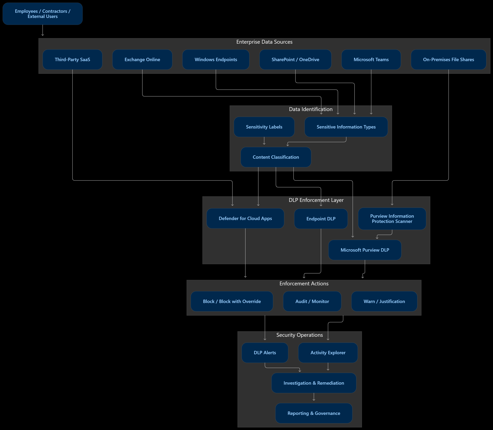

## Below Architecture is based on m365 environment

| Component | Responsibility |
|---|---|
| Sensitive Information Types | Detect information such as financial records, personal information and payment card data. |
| Sensitivity Labels | Identify the classification and protection requirements of documents. |
| Purview DLP | Apply policies across supported Microsoft 365 workloads and devices. |
| Endpoint DLP | Monitor and restrict activities involving sensitive files on managed endpoints. |
| Defender for Cloud Apps | Provide cloud application visibility and supported real-time session controls. |
| Purview Scanner | Discover and classify sensitive information in supported on-premises repositories. |
| Activity Explorer | Review DLP-related activities and user actions. |
| DLP Alerts | Identify policy matches requiring investigation. |

